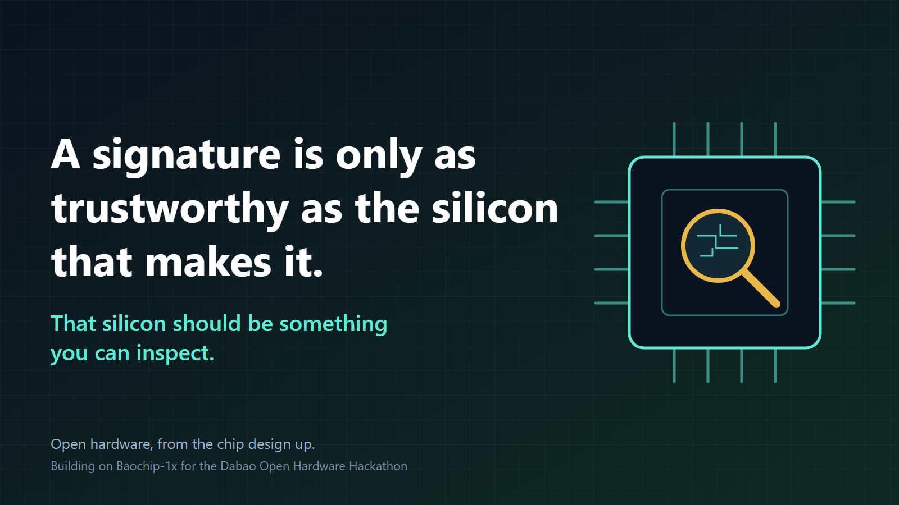

# Universal Ethereum Signer

> **This branch (`touch-confirm`)** adds touch-to-confirm to the dabao burner, for the Dabao Open Hardware
> Hackathon: the signer on a bare Baochip-1x board only signs after a fingertip touches a pad, sensed by one
> of the chip's BIO cores with no added parts. See
> [dabao-app-eth-burner](dabao-app-eth-burner/README.md) for why open hardware matters here, how it works
> and what has run on a real board.
>
> 

The Universal Ethereum Signer is a reference implementation for Ethereum hardware signers. 

This monorepo is opinionated towards Rust and feature rich ("Mb RAM class") embedded multi applications Operating Systems, reuse of existing well maintained libraries (such as [alloy](https://alloy.rs/)), and development fully driven by automatic programming.

## common-eth-signer 

This crate contains abstractions of the different Ethereum primitives needed for a wallet

It has no dependencies on the underlying Operating System

## keyos-app-eth-signer

An implementation of the signer for [Foundation](https://foundation.xyz/) Passport Prime for KeyOS

In this version the signer is airgapped using [ERC-4527](https://github.com/ethereum/ercs/blob/master/ERCS/erc-4527.md) QR codes and implements [Verifiable Signing](verifiable_signing/README.md) using [ERC-8213](https://erc8213.eth.limo/) - it has no dependencies whatsoever on any external data source.  

Future versions will implement different bearers and optionally [Clear Signing](https://clearsigning.org/), with additional third party dependencies

## dc34-app-eth-signer

An implementation of the signer for the [Xous microkernel](https://github.com/betrusted-io/xous-core) running of the [Def Con 34 badge](https://defcon.org/34b/) (baosec-lite)

In this version the signer is airgapped using [ERC-4527](https://github.com/ethereum/ercs/blob/master/ERCS/erc-4527.md) QR codes and implements [Verifiable Signing](verifiable_signing/README.md) using [ERC-8213](https://erc8213.eth.limo/) - it has no dependencies whatsoever on any external data source.  

Future versions will implement different bearers and optionally [Clear Signing](https://clearsigning.org/), with additional third party dependencies

## dabao-app-eth-burner

A burner signer for the [Xous microkernel](https://github.com/betrusted-io/xous-core) on a bare dabao (no screen): a random seed is created on the first boot from the chip TRNG, and every request received over USB HID is signed at once, without review. For test networks and small amounts only; see its [README](dabao-app-eth-burner/README.md)

## Security

See [SECURITY.md](SECURITY.md) for up to date information

At this time, this project has not yet been audited by a dedicated human. Use only with assets you can afford to lose.  
