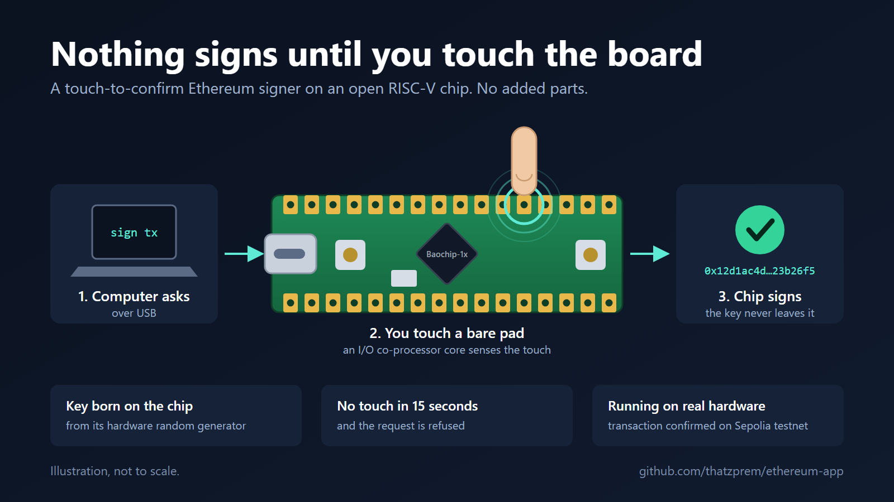
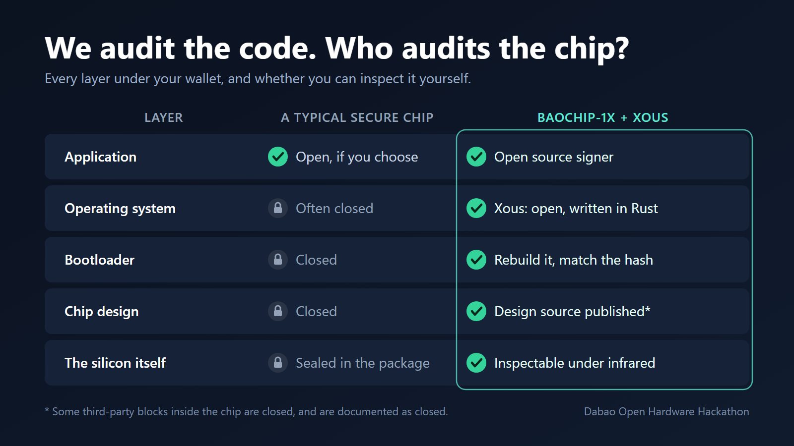

# Ethereum burner for dabao

`eth-burner` is an Ethereum signer for a bare [dabao](../../xous-core/apps-dabao/README.md) (Xous on a
bao1x, no screen): a burner wallet with no PIN and no recovery phrase, which signs only when the pad
`PB1` is touched.



## Why open hardware

We verify our software. We still take our chips on faith.

Every wallet, password manager and secure login rests on a chip that nobody outside the manufacturer can
inspect. The code on top can be open source and audited line by line, and it still runs on a black box. If
the silicon has a flaw or a backdoor, no amount of software review will find it. Open hardware changes the
question from "do you trust the vendor?" to "can you check?"



The Baochip-1x that this signer runs on is a RISC-V microcontroller where that checking is possible at each
layer:

* The chip's design source is published.
* The package lets you image the silicon under infrared light and compare it with that design.
* The bootloader can be rebuilt from source and matched, hash for hash, against what the chip reports.
* The operating system, Xous, is open and written in Rust.

It isn't entirely open: some third-party blocks inside the chip are closed, and they are documented as
closed. The left column of the picture is a generalisation; some commercial chips publish more than that.

What this signer adds on top is small and concrete:

* The private key is made by the chip's own hardware random number generator and never leaves it.
* Nothing is signed until a finger touches a bare pad on the board. No part is added: one of the chip's I/O
  co-processor (BIO) cores measures the touch.
* No touch within 15 seconds, and the request is refused.

It runs on a real board. A transaction signed by it is confirmed on the Sepolia test network:
[`0xdd4a2bfe…e7835b84`](https://sepolia.etherscan.io/tx/0xdd4a2bfe3d43b7757218c0c065b9a6da3c3ac6c1536d0fe2f421af15e7835b84)
(signed with 0.1.0, before the touch was required).

What it does not do yet: show what is being signed. The touch says "sign", not "sign this". A display is
the next step.

The pictures in `docs/` are illustrations, not photographs of the board or of its silicon.

## How it works

The host talks to it over a single vendor-defined USB HID interface (xous-core's
`--feature usb-bao1x/generic-hid`, on its `dabao-burner` branch) or, in the emulator, over a TCP socket.
Messages are `length (u32 BE) || type || CBOR`; see [`protocol.cddl`](protocol.cddl).

* On the first boot it creates a random seed (32 bytes of BIP-39 entropy, the equivalent of a 24-word
  phrase) from the chip TRNG: the TRNG service and the kernel's hardware entropy pool, mixed with SHA-256.
  It is stored in keystore application slots 132 (entropy) and 133 (`ETHBURN1` and a SHA-256 check,
  written last); later boots load it.
* The seed is never shown or exported: whatever the burner holds can't be recovered elsewhere.
* get-version and get-address (any path) are answered at once. Transactions, EIP-712 typed data and
  EIP-191 messages are signed only after a touch on pad `PB1`, see [Touch to confirm](#touch-to-confirm)
  (a request whose `address` isn't this key is refused at once, without waiting). **The touch says "sign",
  not "sign this": nothing shows what is being signed. Test networks and small amounts only.**
* The address at `m/44'/60'/0'/0/0` is logged at boot (serial console).
* In the emulator the seed lives in a host file, `target/eth-burner-seed.bin` in this crate or
  `$ETH_BURNER_SEED`; delete it for a new burner. On the device a new seed needs slots 132..133 erased.

## Touch to confirm

A signing request waits up to 15 seconds for a fingertip on the bare pad `PB1` (BIO pin 1); no part is
added to the board. A BIO core measures how long the pad takes to charge through its pull-up
(`bio-lib`'s captouch), which a finger makes longer.

* The untouched level is measured when the request arrives, so a finger already on the pad approves
  nothing: it has to leave and come back. On a dabao the pad idles at a steady 49 (51 at most) and a
  fingertip reads 55 to 200; three readings in a row above idle + 10 % (at least 5) make a touch.
* No touch in time: error 1 (`user-rejected`), with what the sensor saw in the message.
* If the sensor can't be set up, every signing request is refused with error 6 (`not-ready`).
* In the emulator a file stands in for the touch: create `target/eth-burner-approve` in this crate (or
  `$ETH_BURNER_APPROVE`) after the request is sent; it is removed when used, and one created earlier
  doesn't count. `ETH_BURNER_CONFIRM_MS` changes the 15 s.

Two development commands (see `protocol.cddl`) help on a board without a serial console:
`probe-confirm` returns the lowest and highest sensor reading of the next half second, to find the pad
and tune the level, and `reboot` restarts the chip, which lands in the bootloader's mass storage mode so
new firmware can be copied without pressing a button.

## Build and run

With xous-core (branch `dabao-burner`) checked out next to `ethereum-app`, and the Xous toolchain installed
(`cargo xtask install-toolkit` in xous-core):

```sh
./build.sh               # host and device binaries (or ./build.sh emu / ./build.sh device)

# emulator: only the base services (ticktimer, log, names)
cd ../../xous-core
cargo xtask dabao-emu ../ethereum-app/dabao-app-eth-burner/target/release/eth-burner
# in another terminal, from this directory
tools/eth_client.py get-version
tools/eth_client.py get-address "m/44'/60'/0'/0/0"
# each sign command waits for its approval: `touch target/eth-burner-approve` once it is sent
tools/eth_client.py sign-tx --expect <the address logged at boot>
tools/eth_client.py sign-typed-data mail --expect <address>    # EIP-712; also `group` or a JSON file
tools/eth_client.py sign-message 'Hello' --expect <address>    # EIP-191; also siwe or 0xHEX

# device image: the app path must come before the flags
cargo xtask dabao ../ethereum-app/dabao-app-eth-burner/target/riscv32imac-unknown-xous-elf/release/eth-burner \
    --feature usb-bao1x/generic-hid
tools/eth_client.py --hid get-address    # needs `pip install hidapi`
```

`tools/eth_client.py` has no dependencies for TCP (minimal CBOR, RLP, Keccak-256 and secp256k1 recovery in
`tools/ethlib.py`, which also implements EIP-191 and EIP-712 hashing: the sign commands print the expected
hashes and recover the signer from the returned signature); `--hid` uses `hidapi` and opens
VID 0x1d50 / PID 0x6197. `ETH_BURNER_PORT` changes the emulator's TCP port (default 7600).

## Reproduce it from scratch

These are the steps the firmware on the test board was built with, on a clean Linux machine (a GitHub
Codespace, 4 cores; nothing is installed on the PC the board is plugged into). Rust was 1.99.1.

```sh
# 1. the two repositories, side by side
git clone --branch devcon8-workshop https://github.com/thatzprem/xous-core.git     # commit d1d4b9b
git clone --branch touch-confirm    https://github.com/thatzprem/ethereum-app.git

# 2. Rust, and the version tags the Xous build checks for
curl --proto '=https' --tlsv1.2 -sSf https://sh.rustup.rs | sh -s -- -y --profile minimal
. "$HOME/.cargo/env"
cd xous-core
git remote add upstream https://github.com/betrusted-io/xous-core.git
git fetch upstream --tags

# 3. the Xous target for Rust (downloaded from betrusted-io/rust releases)
cargo xtask install-toolkit

# 4. the signer, for the emulator and for the board
cd ../ethereum-app/dabao-app-eth-burner
./build.sh
cargo test --release

# 5. the board image: loader.uf2, xous.uf2 and apps.uf2 in
#    xous-core/target/riscv32imac-unknown-xous-elf/release/
cd ../../xous-core
cargo xtask dabao ../ethereum-app/dabao-app-eth-burner/target/riscv32imac-unknown-xous-elf/release/eth-burner \
    --feature usb-bao1x/generic-hid
```

The images are signed with the public developer key. A bao1x that boots one erases its factory secrets
and counts itself, for good, as a developer device.

To load them, put the board in its bootloader (hold `PROG`, tap `RESET`, release `PROG`): it shows up as a
USB drive named `BAOCHIP`. Copy the three files onto it, then press `PROG` to start. With 0.3.0 or later
already running, the `reboot` command replaces the buttons.

Built this way, `loader.uf2` came out identical from one build to the next and `xous.uf2` did not, most
likely because of the build timestamp. xous-core's `--no-timestamp` flag and the
[baobit](https://github.com/sbellem/baobit) toolchain are the way to byte-for-byte reproducible images;
neither has been tried here.

### Windows host tools

`tools/windows` holds PowerShell scripts that talk to the board with Windows' own HID support: no Python,
no driver, nothing to install (PowerShell 7).

| Script | What it does |
|---|---|
| `dabao-flash.ps1 -Dir <folder> [-AppsOnly]` | asks the signer to reboot, waits for `BAOCHIP`, copies the firmware, starts it and prints the running version |
| `dabao-sign-hello.ps1` | sends an EIP-191 request for `Hello`; touch `PB1` to approve |
| `dabao-touch-meter.ps1` | shows the touch sensor's reading twice a second (`probe-confirm`) |
| `dabao-hid-send.ps1 -Hex <type and message>` | sends one raw request and prints the reply |

They don't check signatures: the signer of a reply was recovered with `tools/ethlib.py`.

## Hardware tests

The checks to run on a real board are in xous-core's
[apps-dabao/HARDWARE-TESTS.md](../../xous-core/apps-dabao/HARDWARE-TESTS.md). Run so far on one dabao
(stepping A0), from a Windows host through raw HID reports:

* 0.1.0: get-version, get-address, sign-message and an EIP-1559 sign-tx, each answered in 80 to 200 ms
  with the signer recovered; the address was the same after reflashing. One such transaction was
  broadcast on Sepolia:
  `0xdd4a2bfe3d43b7757218c0c065b9a6da3c3ac6c1536d0fe2f421af15e7835b84`.
* 0.3.0: sign-message is refused after 15 s without a touch and signed after a touch on `PB1`;
  `probe-confirm` and `reboot` work.

Not run on a board yet: sign-typed-data, the wrong-address refusal, a second board.

## Layout

| Path | Role |
|---|---|
| `src/main.rs` | seed creation and storage (keystore slots or a host file), request handling and signing |
| `src/confirm.rs` | approval of a signing request: touch pad (device) or a file (emulator) |
| `src/protocol.rs` | framing, custom CBOR, HID chunking (unit tested) |
| `src/transport.rs` | HID (device) and TCP (emulator) transports; answers get-version |
| `protocol.cddl` | protocol definition |
| `tools/eth_client.py`, `tools/ethlib.py` | host client and its Ethereum helpers |
| `tools/windows/*.ps1` | Windows host scripts: flash, sign, touch meter, raw requests |
| `docs/` | illustrations for this README |
